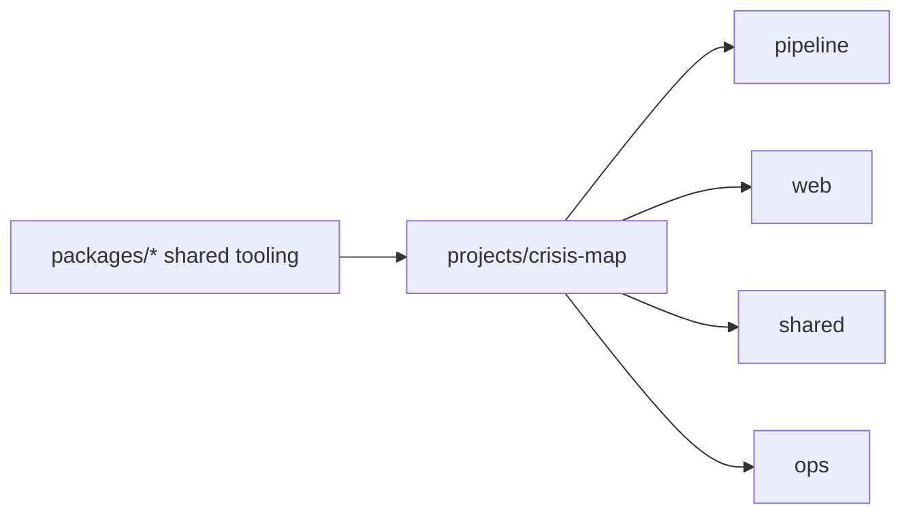

# agentic-projects

Monorepo for the team's products. Crisis Map is the first: a public, non-commercial live map of conflict, unrest, and reported cyber incidents. Setup is in progress. The license is TBD by the owner.

**Crisis Map is non-commercial.** EuRepoC v1.3.2 is CC BY-NC 4.0 and ransomware.live is non-commercial. Do not sell the map or re-serve those sources.



## Layout

| Path                                 | Role                                                      |
| ------------------------------------ | --------------------------------------------------------- |
| `packages/tsconfig`                  | Shared TypeScript bases (`@shared/tsconfig`)              |
| `projects/crisis-map/pipeline`       | Ingest and static publish (stub)                          |
| `projects/crisis-map/web`            | Map UI (stub)                                             |
| `projects/crisis-map/shared`         | Cross-app contracts (stub)                                |
| `projects/crisis-map/ops`            | `@crisis-map/ops`, ESM, `budgets.json`                    |
| `projects/crisis-map/data/reference` | Data Analyst reference lists                              |
| `projects/crisis-map/docs`           | Product docs. `docs/data/` holds the data-rules doc later |
| `docs/`                              | Repo ADRs land here in a follow-up                        |

Root stays shared tooling. Products live under `projects/<product>/`. One product does not import another.

## Scripts

```bash
pnpm install
pnpm lint
pnpm typecheck
pnpm test
pnpm build
pnpm dev
```

Node `>=22.6` (see `.nvmrc`). `@crisis-map/ops` is written so it can run under `node --experimental-strip-types`.

Pages deploy, ingest, and the merge gate are follow-up PRs.
